```
░██    ░██                      ░██            ░██████████                    ░██
░██    ░██                      ░██            ░██
░██    ░██ ░███████ ░████████░████████░██████  ░██        ░████████  ░████████░██░████████  ░███████
░██    ░██░██    ░██░██    ░██  ░██        ░██ ░█████████ ░██    ░██░██    ░██░██░██    ░██░██    ░██
 ░██  ░██ ░█████████░██    ░██  ░██   ░███████ ░██        ░██    ░██░██    ░██░██░██    ░██░█████████
  ░██░██  ░██       ░██    ░██  ░██  ░██   ░██ ░██        ░██    ░██░██   ░███░██░██    ░██░██
   ░███    ░███████ ░██    ░██   ░████░█████░██░██████████░██    ░██ ░█████░██░██░██    ░██ ░███████
                                                                           ░██
                                                                     ░███████
```

**VentaEngine** is a lightweight, modular 3D engine written in Java on top of [LWJGL](https://www.lwjgl.org/)
(OpenGL, GLFW, OpenAL, STB). Scenes, objects, materials, lights and effects are described in JSON resources and
assembled through a small API, so an application is mostly a startup handler that puts prefabs into a scene.

The engine is in active development: the core systems work and are covered by examples, but the API may still change
between minor versions. Known issues and planned work are listed in [ROADMAP.md](ROADMAP.md).

| | | |
|:---:|:---:|:---:|
| <br>Water with Gerstner waves | 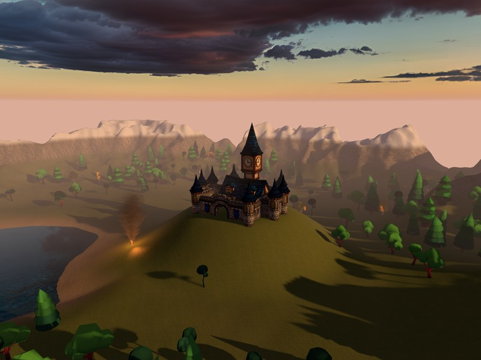<br>Castle by the lake: terrain, water, forest, shadows, fog, particles and 3D sound | 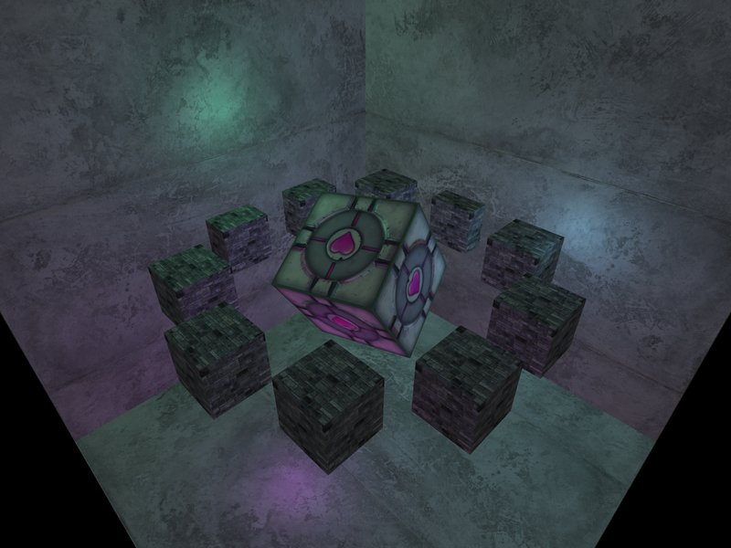<br>Dynamic point lights |
| 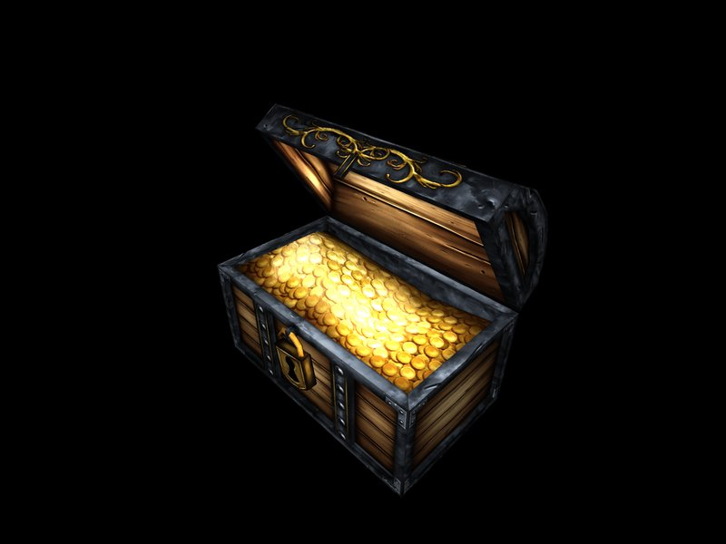<br>OBJ model with textures | 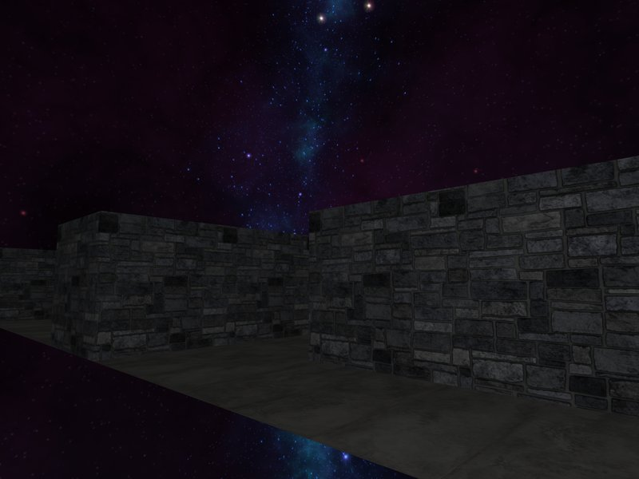<br>Maze | 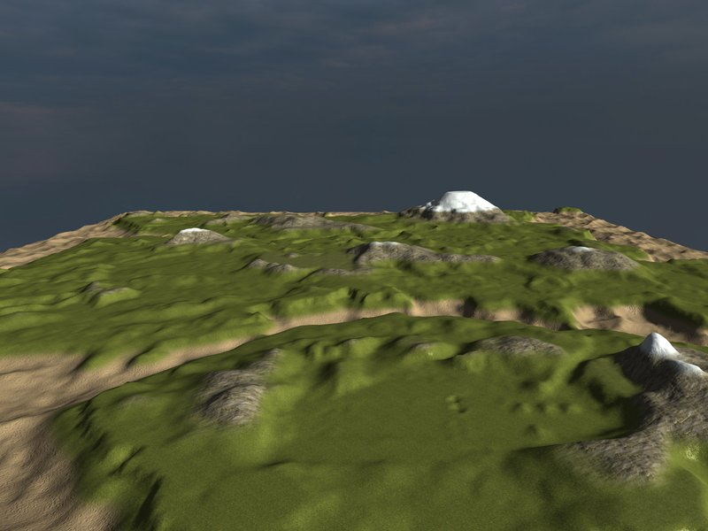<br>Terrain with biomes, normal maps and lighting |
| 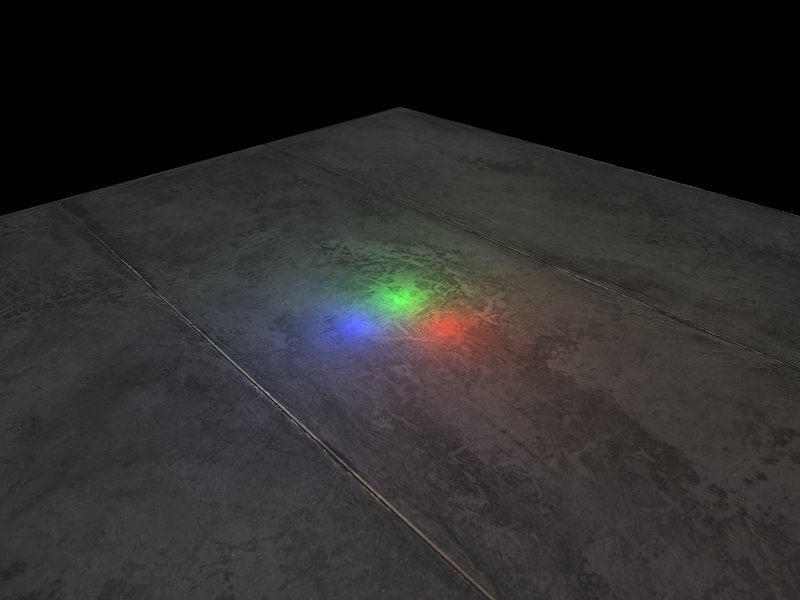<br>Colored point lights | 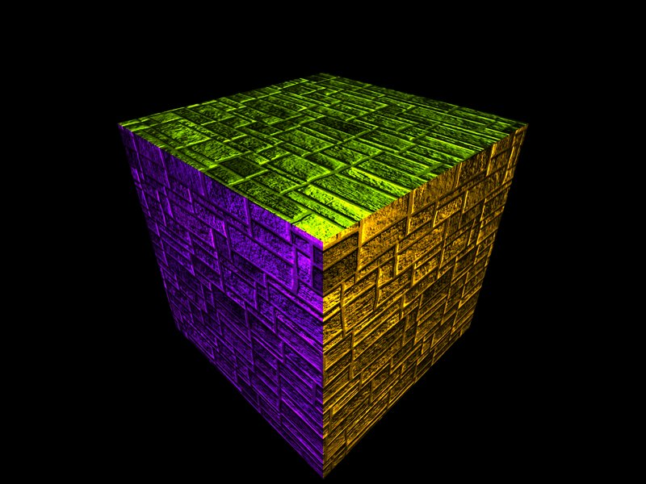<br>Material color and textures | 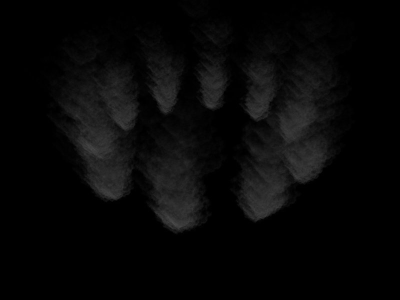<br>Particle emitters |
| 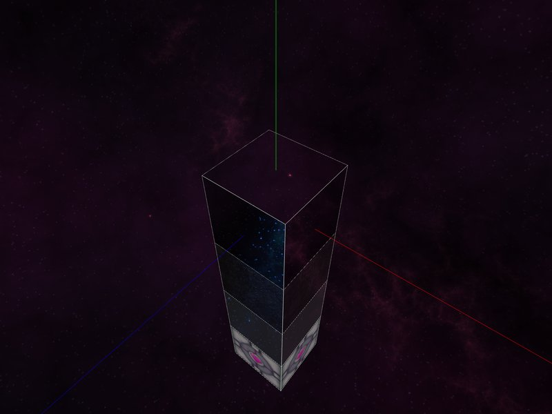<br>Skybox reflections | 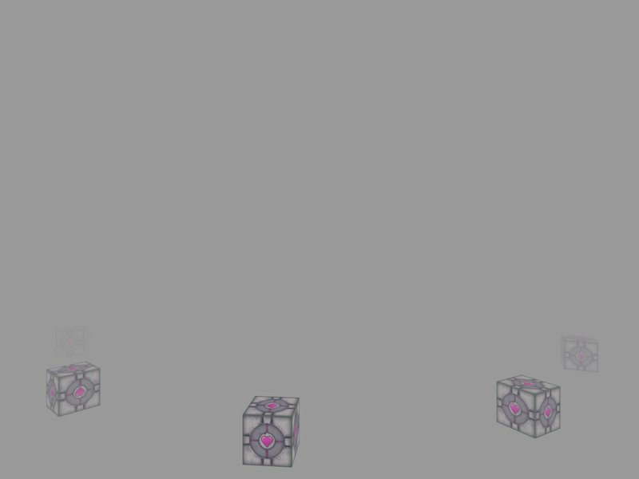<br>Fog | 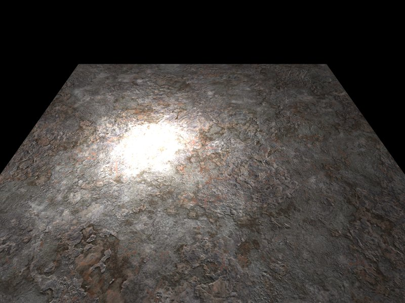<br>Moving light |
| 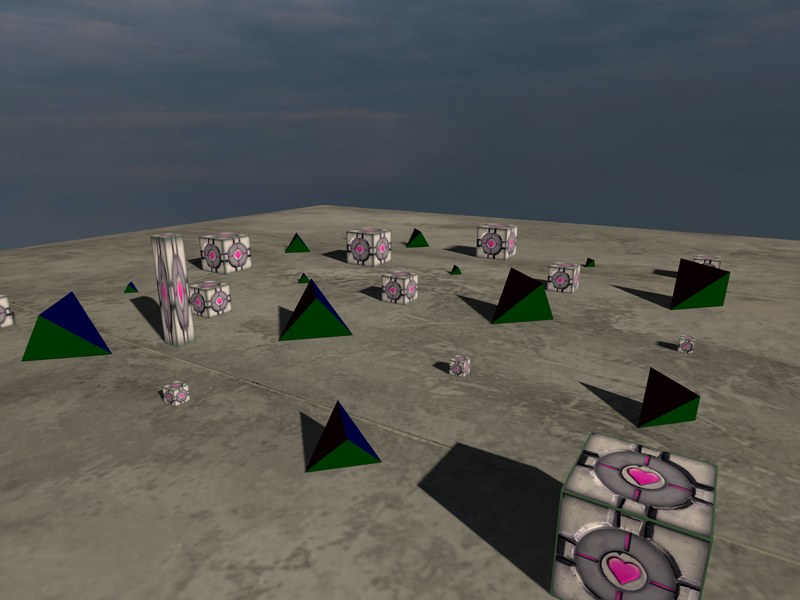<br>Cascaded shadows of the sun | 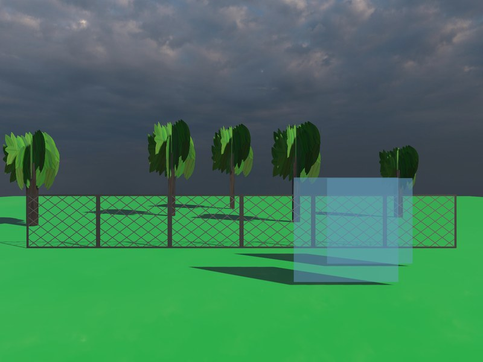<br>Cutout leaves and fence, glass | 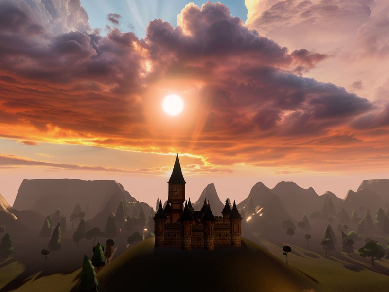<br>Bloom and the disc of the sun |
| 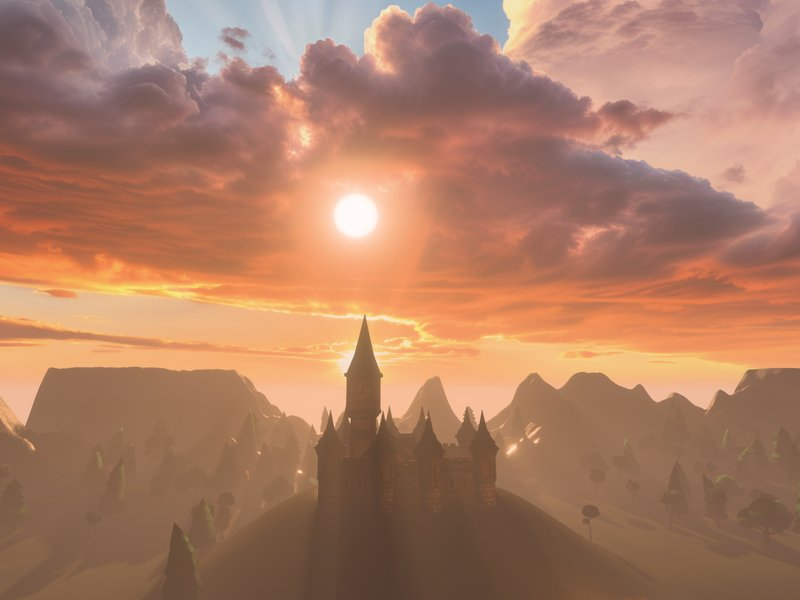<br>Light shafts of the sun in the fog | 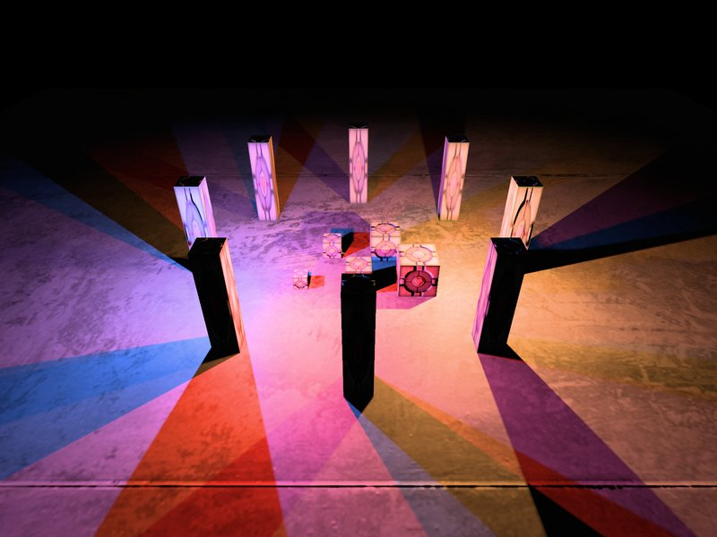<br>Shadows of three point lights | 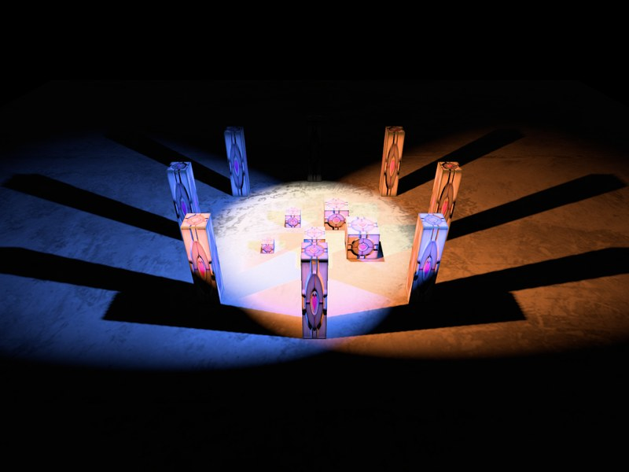<br>Spot lights and their shadows |
| 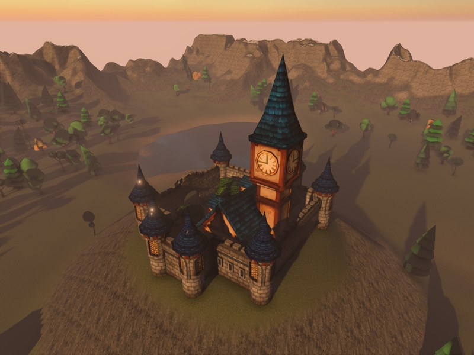<br>Rock on the steep ground of a terrain | 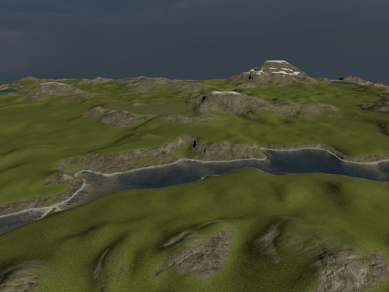<br>Depth of water, the bottom and the foam of the shore | <br>Reflections of the scene in water |
| 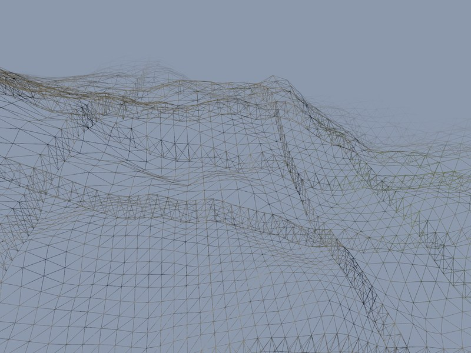<br>Levels of detail of a huge terrain, as lines | <br>An ocean beach at sunrise | 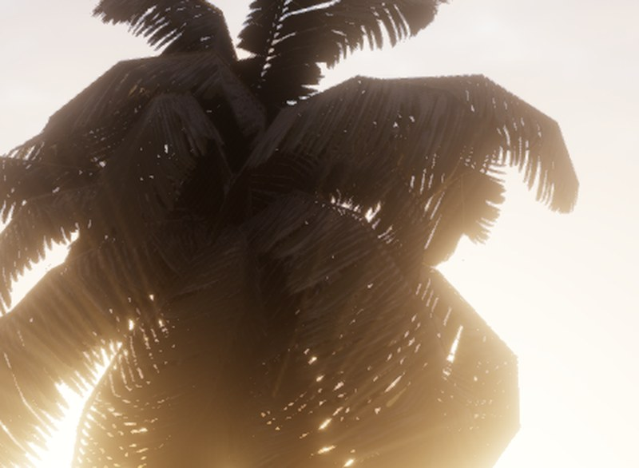<br>The leaves of a palm, smoothed by alpha to coverage |

More screenshots can be produced by running the [examples](#examples).

## Features
* **Window** — windowed and fullscreen modes, vertical synchronization, multisample antialiasing, window icon
* **HDR** — the scene is lit in linear colors (textures and colors of the definitions are sRGB) and rendered into a floating point framebuffer, then tone mapped (`Neutral` by default, `ACES` or `None`) with an exposure per scene (`"exposure"`, `"toneMapping"` in the scene file)
* **Scenes** — scenes described in JSON or built in code, switching between scenes, ambient and directional light, fog, skybox
* **Objects** — meshes from JSON and Wavefront OBJ files, hierarchical objects (a model made of nodes with their own transformations); an OBJ model without a material of its own is split into its groups with the materials of its MTL file
* **Fog** — a layer of fog between two distances with a top (`"distance"`, `"height"` in the `fog` of the scene file) or an exponential fog whose density falls with the height (`"density"` at the `"baseHeight"`, `"falloff"`): it lies in the valleys and thins out on the hills, its thickness along a view ray is computed exactly. The sky is fogged too, so the horizon is hazy, and towards the sun the fog takes its color (`"sunScattering"`, `"sunSharpness"`)
* **Terrain chunks and levels of detail** — a terrain is cut into chunks (the biggest power of two of cells up to 32 that divides its grid; a grid without such a divisor is one chunk): the chunks out of the view of the camera, of a shadow cascade, of a face of a point light or of the reflection of the water are not drawn, and the others are drawn with a level of detail that depends on the distance to the camera (the level n takes every 2^n-th vertex of the grid; the first change is at 1.5 sizes of a chunk, `"lodDistance"` in the terrain file sets it in the units of the world, and every next one is twice as far). The chunks are drawn with one call per view (`glMultiDrawElements`). Where chunks of different levels meet, skirts hang down from their borders and close the cracks. The levels are chosen once in a frame, so every pass draws the same geometry. `scene info` prints the triangles of the terrain of the last frame
* **HDR sky** — a cubemap file may name one panorama instead of six faces: `"equirectangular": "sky/beach.hdr"` (a Radiance `.hdr` file, twice as wide as it is high, read as a floating point picture with the real brightness of the sun and the sky; the center of it looks along -z and the right of it goes to +x), with `"resolution"` (the size of a face of the cube map made of it, 1024 by default) and `"clamp"` (the brightest value that is kept, 256 by default, so the sun that is thousands of times brighter than the sky does not sparkle in the blurred reflections). The cube map is made on the GPU (RGBA16F) and the light of the sky for the surfaces (the image based lighting) is convolved from it, so the sky lights the scene as brightly as it really does. The skyboxes of six 8 bit faces work as before; `.exr` is not read
* **Emissive materials** — a material gives out light of its own: `"emissive"` (a color) with `"emissiveIntensity"` (HDR, can be more than 1), and an `emissive` map (its red channel says where, it multiplies the color; without a map the whole surface glows). It is added to the light the surface gets, so the gold of a chest, a lamp or a window shines in the dark and against the light, without a light source (which would light everything around it); it is a part of the image that the bloom takes
* **Reflections of the other surfaces** — a material with `"dynamicReflections": {"resolution": 256, "refresh": 0.2, "range": 80}` (all three are optional: 128 pixels, 0.25 seconds, 40 meters) makes every object that has it reflect its surroundings and not only the skybox: the scene (the sky, the terrain, the other objects) is drawn from the center of the object into a cube map (RGBA16F with mip levels, the object itself is left out), and the object reads it in place of the sky, the blur of a rough surface is the mip level. The nearest 4 objects to the camera within their `range` have such a cube map, the others reflect the skybox; a frame draws one face of one cube map, so the cost does not depend on the number of the objects (a cube map is refreshed in six frames when its turn comes, and is used when all its faces are drawn; `"refresh": 0` draws it once and keeps it). The objects with a cube map are drawn one by one, without instancing. The cube map is seen from one point, so a big flat object shows its surroundings as if it were a point; the diffuse light stays the light of the skybox, and a scene without a skybox has no dynamic reflections. The water has its own reflection
* **Antialiasing of the cutout edges** — the holes of the cutout materials (`"alphaMode": "cutout"`: leaves, fences) are smoothed by the multisampling too: where the framebuffer of the scene has samples, the shader of a cutout surface doesn't discard the fragments but outputs a sharpened alpha (`(alpha - cutoff) / fwidth(alpha) + 0.5`, so the edge stays one pixel wide at any distance, and a leaf far away doesn't get thin), and alpha to coverage (`GL_SAMPLE_ALPHA_TO_COVERAGE`, the blending is off for these draws) turns it into the share of the samples of the pixel that the fragment covers. There is nothing to set. The shadow maps, the reflection of the water, the cube maps of the reflections (they have no samples) and the objects that fade between levels of detail (their dither needs the discard) keep the discard
* **View of a scene** — `"view"` in the scene file (`near`, `far`, `fov`): the planes of the camera and its field of view, so a scene can see as far as a horizon (the default is 0.1, 1000 and 60 degrees)
* **Surf on a shore** — a water material has `"waveFadeDistance"` (the waves fade out with the distance from the camera, into a flat sea that doesn't shimmer and doesn't need a fine grid far away) and `"swashAmplitude"` with `"swashPeriod"` (the water runs up the shore and back), a foam has `"bands"` (lines of foam that run to the shore from the deep, one after another), and a terrain has `"wetness"` (the sand that the water has wet is darker and smoother, the line follows the swash: give it the level, the amplitude and the period of the water)
* **Reflections in water** — a water with `"reflections": true` in its material mirrors the scene: the nearest such water (in view, with the camera over it) has the geometry and the sky drawn once more as the mirror image of the camera sees it (half the size of the scene, the plane of the water is the near plane of that view by an oblique projection, so what is under the water is cut away by the hardware and the shaders are not touched), and the water finds what it shows by the projection of the mirror image, moved by the ripples and mixed with the sky by the Fresnel term. Particles and billboards are not in it, the other waters and the camera under the water reflect the sky
* **Depth of water** — the geometry is resolved in the middle of the frame (the color and the depth, only when the scene has water), so water reads what lies behind it: the thickness of the water along the view fades the colors out (the light that comes through falls off exponentially, `"depthDistance"` of the material is the depth at which 95% of it is gone), the bottom is seen through the ripples (`"refraction"`, 0 switches it off; shifted points that would drag something that stands out of the water into it are skipped) and the water is covered with foam where it is thin: along the shore and around what stands in it (`"shoreWidth"` and `"shoreIntensity"` of the `foam`; a width of 0 switches it off)
* **Terrain materials by the steepness** — a terrain file may list `"slopeMaterials"` (two at most): materials that cover the ground by its angle to the horizon (`minSlope`, `maxSlope` in degrees, `slopeBlend` for how softly they fade outside), over the materials of the heights, so rock appears on cliffs and not only at a height. They are sampled from three sides (triplanar, with the normal maps put into the world) so the textures don't stretch on steep ground, and the color is mixed with the same texture at a larger scale and turned, so its pattern doesn't repeat in rows. Close to the camera (15 to 60 units) the normal map of the material is added again at a finer tiling (detail normal)
* **Spot lights** — a light file with `"type": "Spot"` shines in a cone (`innerAngle` and `outerAngle` in degrees, up to 85 for the outer one): full light inside the inner angle, fading smoothly to nothing at the outer one, along the direction of the light (`setDirection` in code, `"direction"` of the light in the scene file; down when it is not set). A spot light uses the same range, attenuation and shaders as a point light, and with `"castShadows": true` it casts shadows from one face (a plain shadow map with the perspective of its cone, one pass instead of six), sharing the four slots of the shadows of the point lights. A scene holds up to 32 lights
* **Point light shadows** — a point light with `"castShadows": true` casts shadows: a cube of depths (six faces, 512×512) is drawn for the few nearest such lights (four at most, the others stay without) and the surfaces, the terrain and the water read it. A light fades smoothly to nothing at its `"range"`, which is also how far its shadows reach; a light without a range reaches as far as its attenuation does and has shadows up to 50 units
* **Ambient occlusion** — the corners and the contacts (the foot of a tower, the roots of a tree, the courtyard of a castle) are darker: the occlusion is estimated from the depth of the scene alone (the normals are rebuilt from it), in an image of half the size, blurred with the weights of the depth so it doesn't leak over the edges, and multiplies the scene. `"ambientOcclusion"` in the scene file (`intensity`, `radius` in the units of the world, `power`). It darkens the direct light there too, because the shaders give one color
* **Light shafts** — the light of the sun that the exponential fog scatters towards the camera: a march along every view ray tests its points against the shadow maps of the sun, so the gaps between the trees, the towers and the hills are bright and the shadows are dark. `"lightShafts"` in the scene file (`intensity`, `steps`, `anisotropy`), they need an exponential fog and the shadows of the sun. The march is made at half the resolution and enlarged by the lengths of the rays, so the shafts don't leak over the edges
* **Antialiasing of the finished image (FXAA)** — the multisampling smooths the geometry only, so a pass over the tone mapped image smooths the edges it leaves (the alpha cutout leaves, the edges of the bloom and of the shafts): the edges are found by the contrast of the brightness, searched along to their ends and the pixels on them are mixed with the other side. `"antialiasing"` in the scene file (`type`: `FXAA` or `None`, `quality`: `Low`, `Medium` or `High` for how far the search goes along an edge, `subpixel` for the lines thinner than a pixel, `edgeThreshold` for the contrast of an edge), off without it. The overlays (the console, the text) are drawn after it and stay sharp
* **Bloom** — the bright parts of the HDR image glow: they are blurred over up to six scales (a chain of reductions and enlargements with a soft threshold, the sparks are tamed) and added back before the exposure. `"bloom"` in the scene file (`intensity`, `threshold`, `softKnee`), off without it. The sun can be drawn as a disc in the sky that is far brighter than the sky (`"discSize"`, the radius in degrees, and `"discIntensity"` in the `directionalLight`), so it glows with the bloom
* **Levels of detail** — an object can have simpler models (`"lods"` in the object file: `"screenSize"`, the share of the screen height below which a level is drawn, and the `"root"` of the model); the level follows the size of the object on the screen, with a hysteresis, and a change of the level is a cross fade (dithered). The last level can be a card with a picture of the object that is turned to the camera (`"facing": true`, a quad in the plane of x and y with a cutout material). Objects with levels are drawn with instancing (cutout and opaque surfaces, default shader); the others take the main model
* **Materials** — color, tiling, offset, metalness and roughness, and diffuse, normal, height (parallax), roughness,
  metalness and ambient occlusion maps; surfaces are shaded physically (Cook-Torrance with GGX, Smith and Schlick)
* **Alpha** — a material mixes colors by its alpha (`"alphaMode": "blend"`, the default; such objects are drawn from the farthest to the nearest) or cuts holes (`"alphaMode": "cutout"`, `"alphaCutoff"`): leaves, grass and fences need no sorting and cast shadows with holes, or ignores the alpha (`"alphaMode": "opaque"`): buildings, rocks and trunks need no sorting either, and objects of cutout and opaque surfaces are drawn with instancing; `"doubleSided": false` draws only the front faces
* **Lights** — up to 64 point lights per scene with color, intensity and attenuation
* **Image based lighting** — the skybox of a scene is convolved on the GPU once (diffuse irradiance, specular prefiltered by roughness, BRDF table), so objects and terrain take the color of the sky around them and metals reflect it; `ambientLight` of a scene multiplies the light of the sky, and a scene without a skybox has a flat ambient light
* **Shadows** — the sun casts cascaded shadow maps (4 cascades, 2048×2048, soft edges) on objects, terrain and water: `"castShadows": true` and `"shadowDistance"` in the `directionalLight` of the scene file; off by default
* **Terrain** — grid mesh displaced by a heightmap, materials blended by elevation
* **Water** — grid mesh animated by Gerstner waves and noise, reflections of the skybox
* **Effects** — instanced particle emitters, animated billboards (sprites), transparency
* **Audio** — 3D sound sources (OGG Vorbis) with OpenAL; the engine also starts without an audio device
* **Text** — text rendering with TrueType fonts
* **Developer tools** — console with commands (F12), debug mode with gizmos for objects, lights, cameras and emitters
* **Resources** — loading from the classpath or from `.vea` archives built by the editor
* **Dependency injection** — a small DI container that creates and wires the engine components

## Modules
| Module | Published | Description |
|---|---|---|
| `container` | yes | Dependency injection container: scans packages for `@Component` classes, injects constructor dependencies (including lists), detects cycles and closes `AutoCloseable` components on shutdown. Also provides the event bus used by the engine and the editor |
| `engine` | yes | The engine: window and input, OpenGL rendering, audio, resource loading, scenes, console and the public API (`VentaEngine`, `VentaContext`) |
| `editor` | no | JavaFX tool to build resource archives and to prepare textures (heightmap generator, texture mixer, texture packer) |
| `studio` | no | The editor of scenes in a JavaFX window: the engine draws the scene into its viewport, in the same process |
| `examples` | no | Example applications, one per feature, with their resources |

## Getting started
The engine requires Java 25+ and OpenGL 3.3+. On macOS start applications with the VM argument `-XstartOnFirstThread`.

### Dependency
```xml
<dependency>
    <groupId>io.github.trimax</groupId>
    <artifactId>engine</artifactId>
    <version>1.3.0</version>
</dependency>
```

### Native libraries
The published `engine` artifact doesn't depend on LWJGL native libraries, so an application adds them for the platforms
it runs on. The classifier is one of `natives-linux`, `natives-linux-arm64`, `natives-windows`, `natives-windows-arm64`,
`natives-macos`, `natives-macos-arm64`, and it is needed for `lwjgl`, `lwjgl-opengl`, `lwjgl-glfw`, `lwjgl-stb` and `lwjgl-openal`.
Importing `lwjgl-bom` of the same LWJGL version as the engine keeps the versions of all LWJGL artifacts aligned:

```xml
<dependencyManagement>
    <dependencies>
        <dependency>
            <groupId>org.lwjgl</groupId>
            <artifactId>lwjgl-bom</artifactId>
            <version>3.4.3</version>
            <type>pom</type>
            <scope>import</scope>
        </dependency>
    </dependencies>
</dependencyManagement>

<dependencies>
    <dependency>
        <groupId>org.lwjgl</groupId>
        <artifactId>lwjgl</artifactId>
        <classifier>natives-macos-arm64</classifier>
    </dependency>
    <!-- the same for lwjgl-opengl, lwjgl-glfw, lwjgl-stb and lwjgl-openal -->
</dependencies>
```

See `examples/pom.xml` for a setup that picks the classifier of the current platform via Maven profiles.

### Minimal application
An application implements `VentaEngineApplication` and starts the engine. The startup handler gets a `VentaContext`
with access to all managers, registries and repositories:

```java
public final class ChestApplication implements VentaEngineApplication {
    @Override
    public @NonNull VentaEngineStartupHandler getStartupHandler() {
        return new VentaEngineStartupHandler() {
            @Override
            public void onStartup(final String[] args, final VentaContext context) {
                final var scene = context.getSceneManager().getCurrent();

                final var chest = context.getObjectManager().create("chest", context.getObjectRepository().get("chest.json"));
                scene.add(chest);

                final var light = context.getLightManager().create("light", context.getLightRepository().get("point.json"));
                light.setPosition(new Vector3f(3.f, 3.f, 3.f));
                scene.add(light);

                final var camera = context.getCameraManager().getCurrent();
                camera.setPosition(new Vector3f(5.f, 5.f, 5.f));
                camera.lookAt(new Vector3f(0.f));
            }
        };
    }

    public static void main(final String[] args) {
        VentaEngine.run(args, new ChestApplication());
    }
}
```

Besides the startup handler an application can provide:
* `VentaEngineConfiguration` — window (title, size, fullscreen) and render settings (console, debug mode, mouse cursor,
  vertical synchronization, antialiasing)
* `VentaEngineUpdateHandler` — called every frame with the elapsed time
* `VentaEngineInputHandler` — key, mouse move and mouse button events

## Glossary
| Term | Meaning |
|---|---|
| **Entity** | A shared resource loaded once and owned by the engine: mesh, texture, texture array, cube map, material, shader, program, font, sound, sprite, grid mesh. Entities hold GPU or audio objects |
| **Registry** | Loads entities from resources on first use, caches them by resource path and releases them on shutdown (`TextureRegistry`, `MeshRegistry`, `ProgramRegistry`, ...) |
| **Prefab** | An immutable template of something that can be placed into a scene, described in JSON: object, light, emitter, billboard, sound source, terrain or water surface, scene |
| **Repository** | Loads prefabs from resources and caches them (`ObjectRepository`, `LightRepository`, `SceneRepository`, ...) |
| **Instance** | A runtime object created from a prefab, with its own state such as position, rotation and scale: object, light, emitter, billboard, sound source, surface, camera, scene. Instances are what an application manipulates |
| **Manager** | Creates, stores and deletes instances (`ObjectManager`, `LightManager`, `SceneManager`, `CameraManager`, ...). A deleted instance is removed from all scenes and its resources are released |
| **Scene** | A set of instances rendered together, plus scene-wide settings: ambient light, directional light, fog and skybox. One scene is current at a time. An instance can be in one scene at most: to move it, remove it from the old scene first; to show the same thing in two scenes, create another instance from the same prefab (meshes and textures are shared). Deleting a scene detaches its instances but doesn't delete them, including the ones created from the scene file: the application deletes them with their managers when they are not needed |
| **Context** | `VentaContext` — the facade an application gets in its handlers; it gives access to managers, registries, repositories, input state and archives |
| **Gizmo** | A helper mesh drawn in debug mode to show where an object, light, camera or emitter is |
| **Controller** | Owns an engine subsystem and its state: window, keyboard, audio, console, text and the engine itself |
| **Renderer** | Draws one kind of entity or instance (scene, object, terrain, water, billboard, emitter, skybox, console, debug) |
| **Binder** | Uploads uniforms and binds textures for a shader program (materials, lights, fog, waves, ...) |
| **Executor** | Implements a console command (`scene list`, `engine debug`, ...) |
| **Updater** | Advances instances every frame (scenes and particle emitters) |
| **Archive** | A `.vea` file built by the editor that packs resources; registered with `VentaContext.registerArchive` and checked before the classpath |
| **Component** | A class annotated with `@Component` that the DI container creates and injects |

## Resources
Resources are loaded from the classpath (or from registered archives) by folder:

| Folder | Content |
|---|---|
| `scenes/` | Scene prefabs: objects, lights, emitters, billboards, sound sources, terrain and water surfaces, fog, skybox |
| `objects/` | Object prefabs: a mesh (or a hierarchy of nodes) with materials and a program |
| `meshes/` | Meshes in JSON or Wavefront OBJ with their MTL material libraries (MTL texture paths are relative to `textures/`) |
| `materials/` | Materials: color, parameters and texture maps |
| `textures/`, `texturearrays/` | Textures (PNG, JPEG, ...) and texture arrays |
| `cubemaps/` | Cube maps for skyboxes |
| `lights/` | Light prefabs |
| `emitters/`, `sprites/`, `billboards/` | Particle emitters, sprite animations and billboards |
| `gridmeshes/`, `surfaces/terrain/`, `surfaces/water/` | Grid meshes and terrain and water surfaces |
| `sounds/`, `soundsources/` | Sounds (OGG Vorbis) and sound source prefabs |
| `programs/`, `shaders/` | Shader programs and GLSL shaders; a line `#include "common/fog.glsl"` of a shader is replaced with the file (the path is relative to `shaders/`, a file is included once per shader), the code used by several shaders is in `shaders/common/` |
| `fonts/` | TrueType fonts |

The engine has default resources (default program, textures, font, gizmo meshes), so an application provides only its own.

## Developer console
When `isConsoleEnabled` is set in the render configuration, F12 opens the console. Type `help` to list the commands,
`<command> help` to see subcommands:

| Command | Subcommands |
|---|---|
| `engine` | `info`, `debug`, `time`, `stop` |
| `scene` | `list`, `info`, `describe`, `create`, `select`, `delete` |
| `camera` | `list`, `info`, `describe` |
| `object`, `light`, `material`, `mesh`, `texture` | `list`, `describe` |
| `system` | `info`, `time` |
| `console` | `info`, `clear` |

## Editor
`editor` is a JavaFX application (`io.github.trimax.venta.editor.VentaEditor`):
* **Archive** — organizes resources into groups (textures, meshes, materials, scenes, ...) and builds a `.vea` archive
  the engine can load; the project itself is saved as JSON
* **Heightmap generator** — generates heightmaps from Perlin noise for terrain surfaces
* **Texture mixer** — combines channels of several textures into one texture (for example, roughness, metalness and
  ambient occlusion maps)
* **Texture packer** — packs textures into an atlas

## Studio
`studio` is the editor of scenes (`io.github.trimax.venta.studio.StudioLauncher`), it is being built step by step. Start it with
`java -jar studio/target/studio-<version>.jar --project <folder>` (without the argument it opens the project that was open last).
* **Project** — a folder that is laid out like the resources of an application (`scenes/`, `objects/`, `materials/`,
  `textures/`, ...): its files are the resources of the studio before the archives and the classpath, and they are read from the disk
  whenever they are needed. `examples/src/main/resources` is a project. Opening a project when one is open starts another window
* **Viewport** — the engine draws into a hidden window of the size of the panel, and the finished image is shown in the window. The
  camera flies (right mouse button looks, `W` `A` `S` `D` `Q` `E` move, `Shift` is faster, the wheel dollies), orbits the chosen thing
  (`Alt` and the left button), pans (the middle button), turns to the chosen thing (`F`, or a double click in the hierarchy) and goes to
  the views Perspective, Top, Front and Side
* **Choosing** — a click chooses the thing under the mouse: the ray of the pixel meets the boxes of the objects and the marks of the
  lights, the emitters, the billboards and the sounds. The chosen thing has a frame; a grid of the ground and the marks are drawn over
  the finished image, they are hidden by what is in front of them and are not touched by the exposure
* **Panels** — Project (the folders and the files, a scene opens with a double click), Hierarchy (the settings and the things of the
  scene that is open), Inspector (the fields of what is chosen, the contents of a file), Console (the log of the engine)
* The scene is not edited yet; the whole program of the studio is in [ROADMAP.md](ROADMAP.md)

## Examples
Every example is a separate application in `examples` (`io.github.trimax.examples...`). Run them from the repository root:

| Example | Shows |
|---|---|
| `empty.EmptyVentaApplication` | The smallest application |
| `material.texture.TexturedChestVentaApplication`, `material.color.ColoredCubeVentaApplication` | Materials and textures |
| `light.point`, `light.ambient`, `light.dynamic`, `light.moveable` | Point, ambient and moving lights |
| `shadow.ShadowVentaApplication` | Shadows of the sun: cubes and tetrahedrons on a plane under a low sun |
| `lod.LodVentaApplication` | Levels of detail: hundreds of spheres in rows with four levels each (the color tells the level) and cards with a picture, the camera flies along the rows and the log counts the spheres by level |
| `pointshadow.PointShadowVentaApplication` | Shadows of point lights: pillars and cubes in the dark, two lights fly around them and a third stands still, every one throws its own colored shadows |
| `terrainlod.TerrainLodVentaApplication` | Levels of detail of a terrain: a huge terrain (4 by 4 kilometers) drawn as lines, a camera that flies over it; the space key switches to the solid terrain
| `beach.BeachVentaApplication` | An ocean beach at sunrise: a wide sandy beach, the sea with waves that wash up the sand (wet, with foam), a palm and a chest that throw long shadows, a polished ball that reflects the beach around it (dynamic reflections), the sun in the haze, the sound of the surf; a fixed camera that sways a little. The scene is in `scenes/beach.json`
| `spotlight.SpotLightVentaApplication` | Spot lights: pillars and cubes in the dark, a cone over the middle and two cones that sweep over the plane, every one throws its own colored shadows
| `foliage.FoliageVentaApplication` | Cutout materials: trees made of cards of leaves, a chain link fence and panes of glass, with shadows |
| `skybox.SkyboxVentaApplication`, `reflection.ReflectionVentaApplication` | Skybox and reflections |
| `fog.FogVentaApplication`, `transparency.TransparencyVentaApplication` | Fog and transparency |
| `emitter.EmitterVentaApplication`, `billboard.BillboardVentaApplication` | Particles and billboards |
| `gridmesh.terrain.TerrainVentaApplication`, `gridmesh.water.WaterVentaApplication` | Terrain and water surfaces |
| `scene.SceneVentaApplication` | Castle by the lake: the whole scene (sky, sun, fog, terrain, water, a castle, a forest of OBJ trees, a campfire with particles, light and 3D sound) is described in one JSON file, the code only flies the camera around and makes the campfire light flicker |
| `camera.CameraVentaApplication`, `maze.MazeVentaApplication` | Camera control and input handling |
| `sound.SoundVentaApplication` | 3D sound sources |
| `debug.DebugVentaApplication` | Debug mode and gizmos |
| `archive.ArchiveVentaApplication` | Loading resources from an archive |
| `container.ContainerVentaApplication` | The DI container on its own |

## Building and releasing
* `mvn package` builds all modules, runs the tests and checkstyle. Use JDK 25.
* Some tests compile the shaders and call them on the GPU. They need an OpenGL 3.3 context and are skipped without one (the macOS profiles of the root pom run the tests with `-XstartOnFirstThread`, which GLFW requires). The `Build` workflow runs them under Xvfb with the software OpenGL of Mesa and fails when there is no context (`VENTA_REQUIRE_OPENGL`).
* Pushes and pull requests to `main` are built by the `Build` workflow.
* Creating a GitHub release runs the `Release` workflow: it builds the commit of the release tag in the same environment as the
  `Build` workflow (software OpenGL under Xvfb, the tests with OpenGL are not skipped), checks that the tag
  (with an optional `v` prefix) matches the project version, publishes `container` and `engine` (and the parent POM)
  to Maven Central, then bumps the patch version in `main`. For a new minor or major version set it in the project (`1.4.0`) before creating the release, the workflow bumps only the patch version.

## Contribution
Contributions, issues, and feature requests are welcome! Feel free to fork the repository and submit pull requests.
See [ROADMAP.md](ROADMAP.md) for known issues.

## Useful links
- HDRI to cube map converter: https://matheowis.github.io/HDRI-to-CubeMap/
- FBX to OBJ converter: https://convert3d.org/fbx-to-obj
- Free textures: https://www.poliigon.com/textures/free
- Free textures: https://www.textures.com/free
