```
░██    ░██                      ░██            ░██████████                    ░██
░██    ░██                      ░██            ░██
░██    ░██ ░███████ ░████████░████████░██████  ░██        ░████████  ░████████░██░████████  ░███████
░██    ░██░██    ░██░██    ░██  ░██        ░██ ░█████████ ░██    ░██░██    ░██░██░██    ░██░██    ░██
 ░██  ░██ ░█████████░██    ░██  ░██   ░███████ ░██        ░██    ░██░██    ░██░██░██    ░██░█████████
  ░██░██  ░██       ░██    ░██  ░██  ░██   ░██ ░██        ░██    ░██░██   ░███░██░██    ░██░██
   ░███    ░███████ ░██    ░██   ░████░█████░██░██████████░██    ░██ ░█████░██░██░██    ░██ ░███████
                                                                           ░██
                                                                     ░███████
```

**VentaEngine** is a lightweight, modular 3D engine written in Java on top of [LWJGL](https://www.lwjgl.org/)
(OpenGL, GLFW, OpenAL, STB). Scenes, objects, materials, lights and effects are described in JSON resources and
assembled through a small API, so an application is mostly a startup handler that puts prefabs into a scene.

The engine is in active development: the core systems work and are covered by examples, but the API may still change
between minor versions. Known issues and planned work are listed in [ROADMAP.md](ROADMAP.md).

| | | |
|:---:|:---:|:---:|
| <br>Water with Gerstner waves | 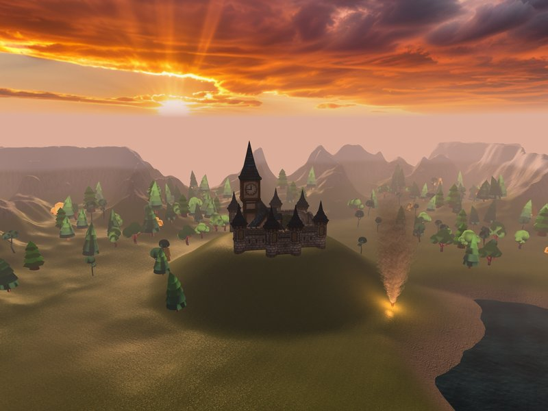<br>Scene with models, skybox and particles | 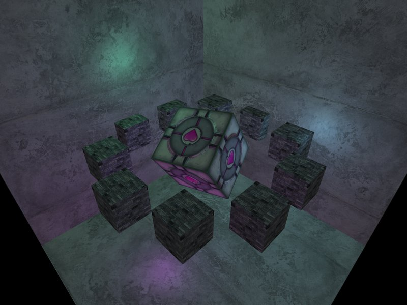<br>Dynamic point lights |
| 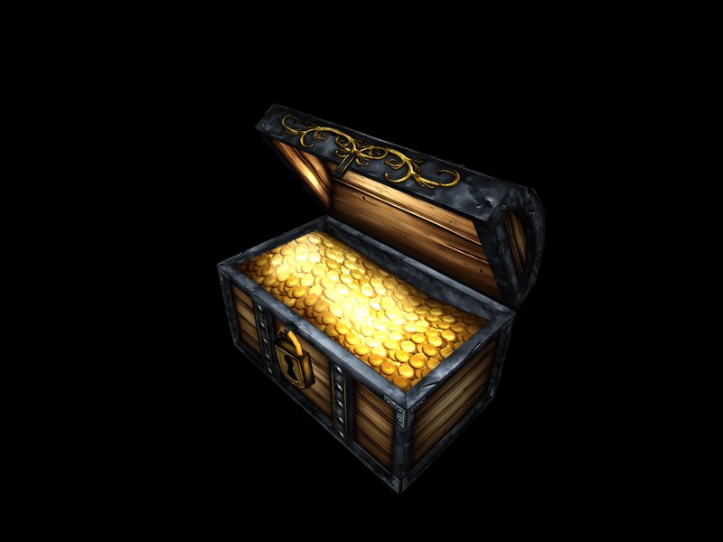<br>OBJ model with textures | 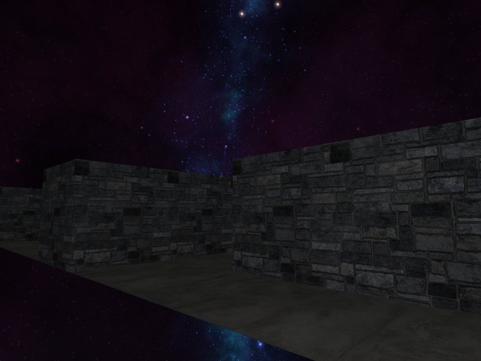<br>Maze | 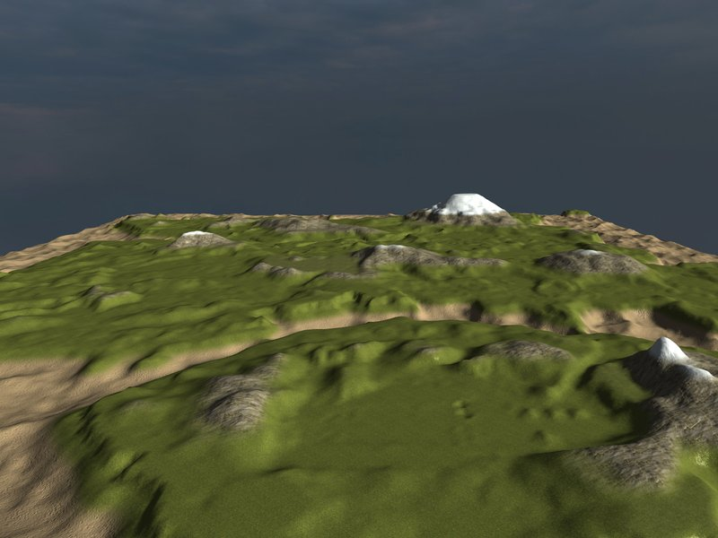<br>Terrain with biomes, normal maps and lighting |
| 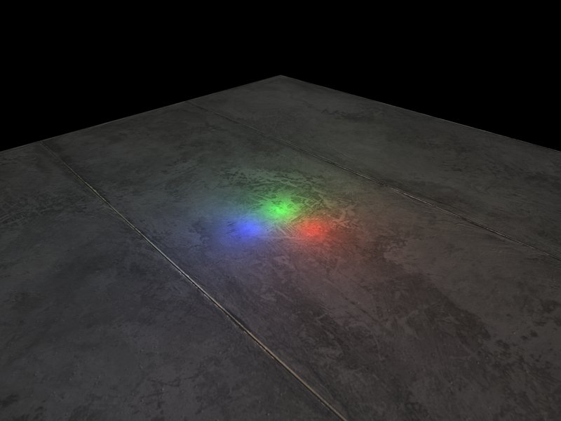<br>Colored point lights | 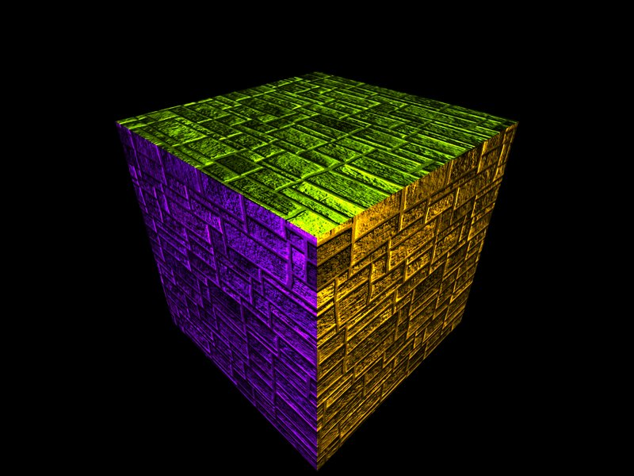<br>Material color and textures | 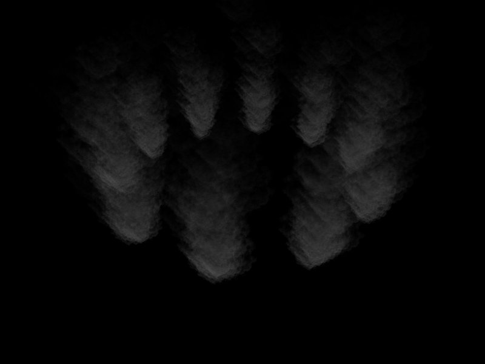<br>Particle emitters |
| 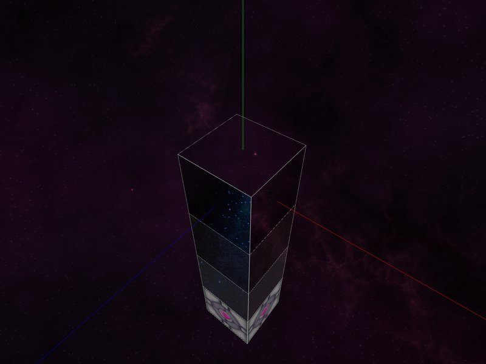<br>Skybox reflections | 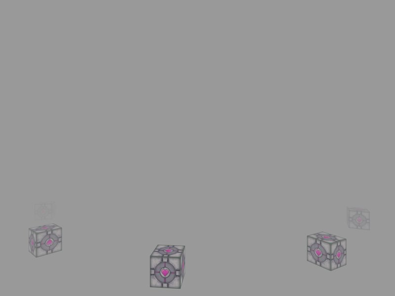<br>Fog | 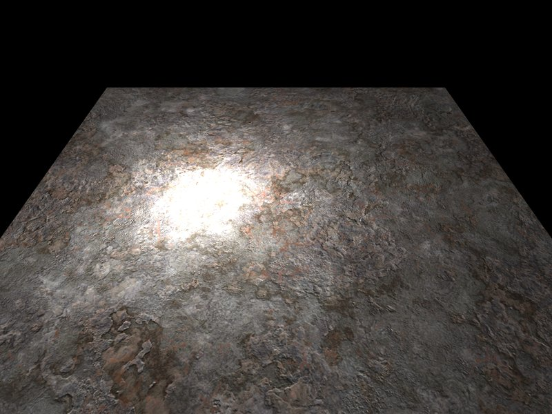<br>Moving light |

More screenshots can be produced by running the [examples](#examples).

## Features
* **Window** — windowed and fullscreen modes, vertical synchronization, multisample antialiasing, window icon
* **Scenes** — scenes described in JSON or built in code, switching between scenes, ambient and directional light, fog, skybox
* **Objects** — meshes from JSON and Wavefront OBJ files, hierarchical objects (a model made of nodes with their own transformations)
* **Materials** — color, tiling, offset, metalness and roughness, and diffuse, normal, height (parallax), roughness,
  metalness and ambient occlusion maps
* **Lights** — up to 64 point lights per scene with color, intensity and attenuation
* **Terrain** — grid mesh displaced by a heightmap, materials blended by elevation
* **Water** — grid mesh animated by Gerstner waves and noise, reflections of the skybox
* **Effects** — instanced particle emitters, animated billboards (sprites), transparency
* **Audio** — 3D sound sources (OGG Vorbis) with OpenAL; the engine also starts without an audio device
* **Text** — text rendering with TrueType fonts
* **Developer tools** — console with commands (F12), debug mode with gizmos for objects, lights, cameras and emitters
* **Resources** — loading from the classpath or from `.vea` archives built by the editor
* **Dependency injection** — a small DI container that creates and wires the engine components

## Modules
| Module | Published | Description |
|---|---|---|
| `container` | yes | Dependency injection container: scans packages for `@Component` classes, injects constructor dependencies (including lists), detects cycles and closes `AutoCloseable` components on shutdown. Also provides the event bus used by the engine and the editor |
| `engine` | yes | The engine: window and input, OpenGL rendering, audio, resource loading, scenes, console and the public API (`VentaEngine`, `VentaContext`) |
| `editor` | no | JavaFX tool to build resource archives and to prepare textures (heightmap generator, texture mixer, texture packer) |
| `examples` | no | Example applications, one per feature, with their resources |

## Getting started
The engine requires Java 25+ and OpenGL 3.3+. On macOS start applications with the VM argument `-XstartOnFirstThread`.

### Dependency
```xml
<dependency>
    <groupId>io.github.trimax</groupId>
    <artifactId>engine</artifactId>
    <version>1.3.0</version>
</dependency>
```

### Native libraries
The published `engine` artifact doesn't depend on LWJGL native libraries, so an application adds them for the platforms
it runs on. The classifier is one of `natives-linux`, `natives-linux-arm64`, `natives-windows`, `natives-windows-arm64`,
`natives-macos`, `natives-macos-arm64`, and it is needed for `lwjgl`, `lwjgl-opengl`, `lwjgl-glfw`, `lwjgl-stb` and `lwjgl-openal`.
Importing `lwjgl-bom` of the same LWJGL version as the engine keeps the versions of all LWJGL artifacts aligned:

```xml
<dependencyManagement>
    <dependencies>
        <dependency>
            <groupId>org.lwjgl</groupId>
            <artifactId>lwjgl-bom</artifactId>
            <version>3.4.3</version>
            <type>pom</type>
            <scope>import</scope>
        </dependency>
    </dependencies>
</dependencyManagement>

<dependencies>
    <dependency>
        <groupId>org.lwjgl</groupId>
        <artifactId>lwjgl</artifactId>
        <classifier>natives-macos-arm64</classifier>
    </dependency>
    <!-- the same for lwjgl-opengl, lwjgl-glfw, lwjgl-stb and lwjgl-openal -->
</dependencies>
```

See `examples/pom.xml` for a setup that picks the classifier of the current platform via Maven profiles.

### Minimal application
An application implements `VentaEngineApplication` and starts the engine. The startup handler gets a `VentaContext`
with access to all managers, registries and repositories:

```java
public final class ChestApplication implements VentaEngineApplication {
    @Override
    public @NonNull VentaEngineStartupHandler getStartupHandler() {
        return new VentaEngineStartupHandler() {
            @Override
            public void onStartup(final String[] args, final VentaContext context) {
                final var scene = context.getSceneManager().getCurrent();

                final var chest = context.getObjectManager().create("chest", context.getObjectRepository().get("chest.json"));
                scene.add(chest);

                final var light = context.getLightManager().create("light", context.getLightRepository().get("point.json"));
                light.setPosition(new Vector3f(3.f, 3.f, 3.f));
                scene.add(light);

                final var camera = context.getCameraManager().getCurrent();
                camera.setPosition(new Vector3f(5.f, 5.f, 5.f));
                camera.lookAt(new Vector3f(0.f));
            }
        };
    }

    public static void main(final String[] args) {
        VentaEngine.run(args, new ChestApplication());
    }
}
```

Besides the startup handler an application can provide:
* `VentaEngineConfiguration` — window (title, size, fullscreen) and render settings (console, debug mode, mouse cursor,
  vertical synchronization, antialiasing)
* `VentaEngineUpdateHandler` — called every frame with the elapsed time
* `VentaEngineInputHandler` — key, mouse move and mouse button events

## Glossary
| Term | Meaning |
|---|---|
| **Entity** | A shared resource loaded once and owned by the engine: mesh, texture, texture array, cube map, material, shader, program, font, sound, sprite, grid mesh. Entities hold GPU or audio objects |
| **Registry** | Loads entities from resources on first use, caches them by resource path and releases them on shutdown (`TextureRegistry`, `MeshRegistry`, `ProgramRegistry`, ...) |
| **Prefab** | An immutable template of something that can be placed into a scene, described in JSON: object, light, emitter, billboard, sound source, terrain or water surface, scene |
| **Repository** | Loads prefabs from resources and caches them (`ObjectRepository`, `LightRepository`, `SceneRepository`, ...) |
| **Instance** | A runtime object created from a prefab, with its own state such as position, rotation and scale: object, light, emitter, billboard, sound source, surface, camera, scene. Instances are what an application manipulates |
| **Manager** | Creates, stores and deletes instances (`ObjectManager`, `LightManager`, `SceneManager`, `CameraManager`, ...). A deleted instance is removed from all scenes and its resources are released |
| **Scene** | A set of instances rendered together, plus scene-wide settings: ambient light, directional light, fog and skybox. One scene is current at a time. An instance can be in one scene at most: to move it, remove it from the old scene first; to show the same thing in two scenes, create another instance from the same prefab (meshes and textures are shared). Deleting a scene detaches its instances but doesn't delete them, including the ones created from the scene file: the application deletes them with their managers when they are not needed |
| **Context** | `VentaContext` — the facade an application gets in its handlers; it gives access to managers, registries, repositories, input state and archives |
| **Gizmo** | A helper mesh drawn in debug mode to show where an object, light, camera or emitter is |
| **Controller** | Owns an engine subsystem and its state: window, keyboard, audio, console, text and the engine itself |
| **Renderer** | Draws one kind of entity or instance (scene, object, terrain, water, billboard, emitter, skybox, console, debug) |
| **Binder** | Uploads uniforms and binds textures for a shader program (materials, lights, fog, waves, ...) |
| **Executor** | Implements a console command (`scene list`, `engine debug`, ...) |
| **Updater** | Advances instances every frame (scenes and particle emitters) |
| **Archive** | A `.vea` file built by the editor that packs resources; registered with `VentaContext.registerArchive` and checked before the classpath |
| **Component** | A class annotated with `@Component` that the DI container creates and injects |

## Resources
Resources are loaded from the classpath (or from registered archives) by folder:

| Folder | Content |
|---|---|
| `scenes/` | Scene prefabs: objects, lights, emitters, billboards, sound sources, fog, skybox |
| `objects/` | Object prefabs: a mesh (or a hierarchy of nodes) with materials and a program |
| `meshes/` | Meshes in JSON or Wavefront OBJ |
| `materials/` | Materials: color, parameters and texture maps |
| `textures/`, `texturearrays/` | Textures (PNG, JPEG, ...) and texture arrays |
| `cubemaps/` | Cube maps for skyboxes |
| `lights/` | Light prefabs |
| `emitters/`, `sprites/`, `billboards/` | Particle emitters, sprite animations and billboards |
| `gridmeshes/`, `surfaces/terrain/`, `surfaces/water/` | Grid meshes and terrain and water surfaces |
| `sounds/`, `soundsources/` | Sounds (OGG Vorbis) and sound source prefabs |
| `programs/`, `shaders/` | Shader programs and GLSL shaders |
| `fonts/` | TrueType fonts |

The engine has default resources (default program, textures, font, gizmo meshes), so an application provides only its own.

## Developer console
When `isConsoleEnabled` is set in the render configuration, F12 opens the console. Type `help` to list the commands,
`<command> help` to see subcommands:

| Command | Subcommands |
|---|---|
| `engine` | `info`, `debug`, `time`, `stop` |
| `scene` | `list`, `info`, `describe`, `create`, `select`, `delete` |
| `camera` | `list`, `info`, `describe` |
| `object`, `light`, `material`, `mesh`, `texture` | `list`, `describe` |
| `system` | `info`, `time` |
| `console` | `info`, `clear` |

## Editor
`editor` is a JavaFX application (`io.github.trimax.venta.editor.VentaEditor`):
* **Archive** — organizes resources into groups (textures, meshes, materials, scenes, ...) and builds a `.vea` archive
  the engine can load; the project itself is saved as JSON
* **Heightmap generator** — generates heightmaps from Perlin noise for terrain surfaces
* **Texture mixer** — combines channels of several textures into one texture (for example, roughness, metalness and
  ambient occlusion maps)
* **Texture packer** — packs textures into an atlas

## Examples
Every example is a separate application in `examples` (`io.github.trimax.examples...`). Run them from the repository root:

| Example | Shows |
|---|---|
| `empty.EmptyVentaApplication` | The smallest application |
| `material.texture.TexturedChestVentaApplication`, `material.color.ColoredCubeVentaApplication` | Materials and textures |
| `light.point`, `light.ambient`, `light.dynamic`, `light.moveable` | Point, ambient and moving lights |
| `skybox.SkyboxVentaApplication`, `reflection.ReflectionVentaApplication` | Skybox and reflections |
| `fog.FogVentaApplication`, `transparency.TransparencyVentaApplication` | Fog and transparency |
| `emitter.EmitterVentaApplication`, `billboard.BillboardVentaApplication` | Particles and billboards |
| `gridmesh.terrain.TerrainVentaApplication`, `gridmesh.water.WaterVentaApplication` | Terrain and water surfaces |
| `scene.SceneVentaApplication` | A scene loaded from JSON |
| `camera.CameraVentaApplication`, `maze.MazeVentaApplication` | Camera control and input handling |
| `sound.SoundVentaApplication` | 3D sound sources |
| `debug.DebugVentaApplication` | Debug mode and gizmos |
| `archive.ArchiveVentaApplication` | Loading resources from an archive |
| `container.ContainerVentaApplication` | The DI container on its own |

## Building and releasing
* `mvn package` builds all modules, runs the tests and checkstyle. Use JDK 25.
* Pushes and pull requests to `main` are built by the `Build` workflow.
* Creating a GitHub release runs the `Release` workflow: it builds the commit of the release tag, checks that the tag
  (with an optional `v` prefix) matches the project version, publishes `container` and `engine` (and the parent POM)
  to Maven Central, then bumps the patch version in `main`.

## Contribution
Contributions, issues, and feature requests are welcome! Feel free to fork the repository and submit pull requests.
See [ROADMAP.md](ROADMAP.md) for known issues.

## Useful links
- HDRI to cube map converter: https://matheowis.github.io/HDRI-to-CubeMap/
- FBX to OBJ converter: https://convert3d.org/fbx-to-obj
- Free textures: https://www.poliigon.com/textures/free
- Free textures: https://www.textures.com/free
